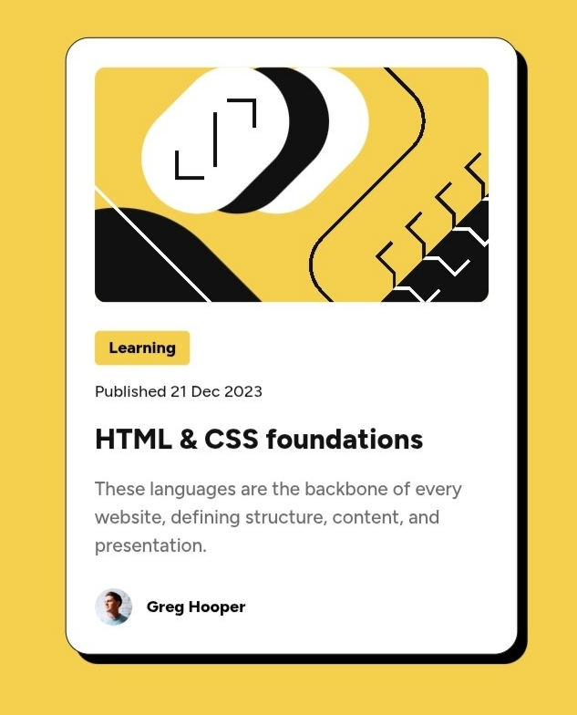

# Frontend Mentor - Blog preview card solution

This is a solution to the [Blog preview card challenge on Frontend Mentor](https://www.frontendmentor.io/challenges/blog-preview-card-ckPaj01IcS). Frontend Mentor challenges help you improve your coding skills by building realistic projects.

## Table of contents

- [Overview](#overview)
    - [The challenge](#the-challenge)
    - [Screenshot](#screenshot)
    - [Links](#links)
- [My process](#my-process)
    - [Built with](#built-with)
    - [What I learned](#what-i-learned)
    - [Challenges](#challenges)
    - [Continued development](#continued-development)
    - [Useful resources](#useful-resources)
    - [AI Collaboration](#ai-collaboration)
- [Author](#author)

## Overview

### The challenge

Users should be able to:

- See hover and focus states for all interactive elements on the page

### Screenshot



### Links

- Solution URL: [Source code](https://github.com/lexbatol-dev/blog-preview-card)
- Live Site URL: [Preview](https://lexbatol-dev.github.io/blog-preview-card/)

## My process

### Built with

- Semantic HTML5 markup (`article`, `time`)
- CSS custom properties
- Flexbox
- A small CSS reset
- `rem` units for font sizes and spacing
- Figma, to compare my build with the design
- [Figtree](https://fonts.google.com/specimen/Figtree) from Google Fonts

### What I learned

This project helped me put several HTML and CSS concepts into practice, especially around spacing and responsive design.

- **Default margins and margin collapsing:** `p` and `h1` come with default margins, and when two vertical margins touch, the bigger one wins. That is why my card was about 12px taller than the Figma design. Now I set each margin myself, and I use a small reset that sets `margin: 0` on `body`, `h1`, `h2`, `h3` and `p`:

    ```css
    body,
    h1,
    h2,
    h3,
    p {
        margin: 0;
    }
    ```

- **Inline elements leave a gap underneath:** an `inline-flex` box sits on a line of text, and that line reserves space below it. Changing `.author` to `display: flex` removed the extra space at the bottom of the card. Images do the same thing, so my reset also includes `img { display: block; }`.
- **`object-fit`:** on mobile, the design keeps the illustration 200px tall and crops its right side. I used a fixed `height` with `object-fit: cover` and `object-position: left` instead of `aspect-ratio`, because `aspect-ratio` made the image shrink and show the whole picture:

    ```css
    .illustration {
        width: 100%;
        height: 12.5rem;
        object-fit: cover;
        object-position: left;
    }
    ```

- **px to rem:** I learned to divide the px value by 16 (24px is 1.5rem and 12px is 0.75rem). I used rem for font sizes and spacing, and kept px for the border, outline and shadow so they stay thin and smooth.
- **Invalid CSS fails silently:** `margin-bottom: 0 0 24px` is invalid because that property takes only one value. The browser ignored the whole line and used the default margins without showing an error, so I only found the problem by comparing the spacing with the design.
- **Reading sizes from a design:** the mobile frame doesn't list font sizes, so I worked them out from the heights of the text boxes. The date and tag are 12px on mobile, and the author name stays at 14px.
- **`100dvh`:** `100vh` pushed my footer below the visible screen in Brave on my phone, and `100dvh` fixed it.

### Challenges

- **Card height:** my card was taller than the design because of the default margins and the `inline-flex` gap. I found both by measuring my card against the Figma frame.
- **Mobile breakpoint:** I first used 380px because that is where the description wrapped differently in DevTools. When I couldn't use my PC, I tested on my phone by using browser zoom to change the width the browser reports. I settled on 420px so that the description keeps three lines, like the design but I later moved to a mobile-first media query that uses rem, after the automated report suggested it.
- **Shared font-size variable:** changing the date and tag to 12px on mobile also shrank the author name, because they used the same variable. I solved it by giving the name its own `0.875rem`.

### Continued development

- I want to keep getting better at spotting default margins and inline gaps myself, instead of finding them by comparing with the design afterwards.
- In future projects, I plan to focus on:
    - Using CSS Grid on a layout with rows and columns, such as a card grid.
    - Getting better at reading Figma files for sizes, spacing and choosing breakpoints from the content.

### Useful resources

- [MDN: @media](https://developer.mozilla.org/en-US/docs/Web/CSS/@media) - The syntax for the media query I used to change the font sizes on smaller screens.
- [MDN: Media query fundamentals](https://developer.mozilla.org/en-US/docs/Learn_web_development/Core/CSS_layout/Media_queries) - This explains how to choose breakpoints, which helped me decide where the text sizes should change.
- [MDN: box-shadow](https://developer.mozilla.org/en-US/docs/Web/CSS/box-shadow) - For the hard offset shadow on the card, with no blur.
- [MDN: Inheritance](https://developer.mozilla.org/en-US/docs/Web/CSS/inheritance) - For understanding `color: inherit`, which I used so the title link takes its colour from the heading and the hover colour works.

### AI Collaboration

I used Claude as a learning mentor throughout this project. Instead of asking it to write the solution, I used it to:

- Plan the HTML structure and choose the right elements.
- Get hints for CSS problems, and review my code.
- Understand hover and focus states and other accessibility points.

I wrote the HTML and CSS myself, which helped me understand each decision.

## Author

- Frontend Mentor - [@lexbatol-dev](https://www.frontendmentor.io/profile/lexbatol-dev)
